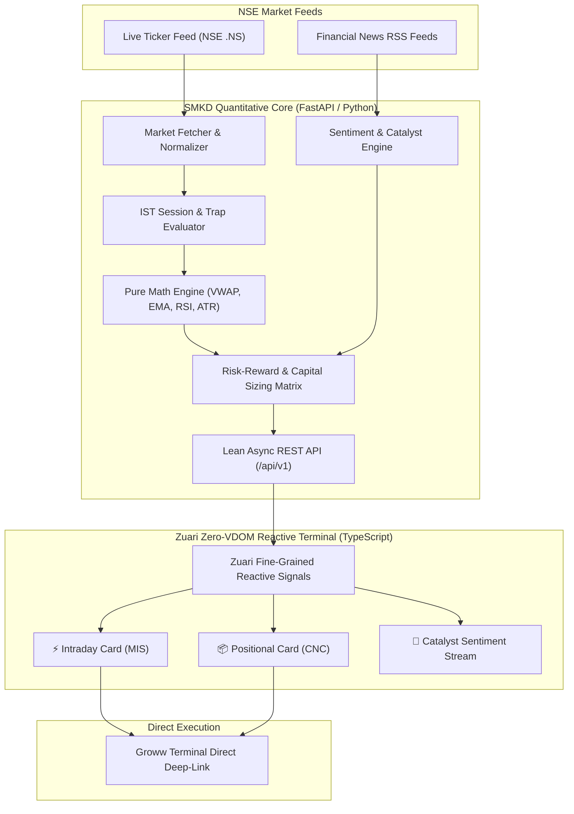

<div align="center">

# ⚡ STOCK MARKET KA DON (SMKD)
### High-Performance Algorithmic Trading Intelligence Engine for Indian Equities (NSE)

[](#-designed--engineered-by-danger-labs)
[](LICENSE)
[](https://python.org)
[](https://fastapi.tiangolo.com)
[](https://www.typescriptlang.org)
[](#-frontend-architecture)
[](https://www.nseindia.com)

<p align="center">
  <b>A production-grade, micro-latency market analysis engine and decision-support terminal built specifically for National Stock Exchange (NSE) equities, covering Intraday (MIS) and Positional Swing (CNC) executions.</b>
</p>

[Key Features](#-key-features) • [System Architecture](#-system-architecture) • [Trading Strategies](#-trading-engine--strategy-matrix) • [Quick Start](#-quick-start--installation) • [API Reference](#-api-specification) • [Limitations & Disclaimer](#-limitations--known-constraints)

---

</div>

## 🏢 Designed & Engineered by Danger Labs

**Stock Market Ka Don (SMKD)** was architected and built by **Danger Labs**, an elite engineering research and quantitative trading systems lab. Danger Labs designs mission-critical algorithmic software, high-frequency signal pipelines, and low-latency reactive frontends.

> *"Precision over hype. Mathematical expectancy over speculation."* — **Danger Labs Core Philosophy**

---

## 📌 Executive Summary

**SMKD** solves the core challenges faced by active retail and prop traders in Indian markets: execution lag, cognitive overload, emotional whipsaws, and scam-ridden signal services that ignore market friction and repainting. 

By unifying **closed-candle mathematical indicators**, **live Indian financial news sentiment NLP**, **automated risk-to-reward boundary calculations**, and a **custom zero-VDOM fine-grained reactive terminal (Zuari Framework)**, SMKD delivers institutional-grade trade setups directly linked to broker execution cards (Groww MIS/CNC).

---

## 🌟 Key Features

| Capability | Specification | Architectural Highlight |
|:---|:---|:---|
| **Intraday Engine (MIS)** | 5-Minute Timeframe Multi-Indicator Confluence | VWAP + 9/21 Dual EMA + 14-period RSI + ATR Dynamic Volatility Bands |
| **Delivery Engine (CNC)** | Daily / Multi-Week Positional Swing Scanner | Golden/Death Crossover (20/50 EMA), Volume Accumulation & Stage-2 Breakouts |
| **News Catalyst NLP** | Live Real-time Sentiment Scraper | RSS pipeline parsing Indian business feeds (Moneycontrol, Mint, ET) with tone scoring |
| **Zero-VDOM UI Terminal** | Built on Danger Labs' `@zuari` signals system | Sub-millisecond reactive DOM mutations without the overhead of heavy Virtual-DOM engines |
| **Trap Avoidance Engine** | Strict IST Market Session Filter | Flags 9:15–9:45 AM opening traps and blocks low-liquidity noon chop zones |
| **One-Click Broker Deep Links**| Instant Contextual Execution Linkage | Directly opens pre-configured symbol order cards on Groww Web/Mobile |

---

## 🏗️ System Architecture

SMKD is engineered as an event-driven decoupled ecosystem:



### Directory Structure

```text
├── fast-framework/             # Danger Labs Submodule: Zuari Reactive Framework
│   └── packages/stock-bot-ui/  # High-speed reactive frontend client
├── launcher/                   # Process supervisor and daemon runtime manager
│   ├── instance_manager.py     # Port allocation, pid tracking & graceful shutdowns
│   ├── launch.py               # Synchronized dual-stack process orchestration
│   └── start.bat               # Single-click Windows deployment script
└── stock-signal-bot/           # Quantitative signal engine core
    ├── backend/app/            # FastAPI analytical server
    │   ├── api/                # Endpoints (/api/intraday, /api/delivery, /api/news)
    │   ├── core/               # Universe configuration (Nifty 100 constituent list)
    │   ├── indicators/         # Pure vectorized mathematical indicators
    │   ├── market/             # Market hours validation & candle aggregation
    │   ├── news/               # Live Indian market RSS aggregator & sentiment analyzer
    │   └── strategies/         # Mathematical confluence scoring algorithms
    └── docs/                   # Institutional trading manuals & design documentation
```

---

## 📊 Trading Engine & Strategy Matrix

### 1. Intraday Momentum Strategy (`Groww MIS`)
* **Timeframe**: 5-Minute closed candles (Strict anti-repainting policy).
* **Confluence Rules**:
  * **Long Entry**: Price > VWAP, 9-EMA > 21-EMA, RSI between 55 and 70 (Momentum acceleration without exhaustion).
  * **Short Entry**: Price < VWAP, 9-EMA < 21-EMA, RSI between 30 and 45.
* **Risk Parameters**:
  * Automated stop-loss pegged to recent swing extremes or $1.5 \times \text{ATR}$.
  * Mandatory minimum Target:Risk ratio of **1:2** to guarantee positive expectancy.

### 2. Positional Swing Strategy (`Groww CNC`)
* **Timeframe**: Daily candle confirmation.
* **Confluence Rules**:
  * 20-Day EMA above 50-Day EMA (Golden Trend Confirmation).
  * Volume expansion > $1.5 \times$ 20-day average volume during breakout sessions.
* **Holding Horizon**: 3 to 15 trading days.

### 3. Anti-Scam & Risk Management Guardrails
* **No Unrealistic Claims**: High-frequency quant funds run between **55% to 65% win rates**. Anyone claiming 90%+ is selling curve-fitted or repainting algorithms.
* **Friction Awareness**: Filters out all micro-moves $< 0.7\%$ to guarantee trades remain profitable after STT, GST (18%), exchange turnover fees, SEBI charges, and broker commission.
* **Liquid Universe Only**: Scans only **F&O eligible constituent stocks** (Nifty 100) to protect capital against illiquid 5% circuit freezes and auction penalties.

---

## ⚡ Quick Start & Installation

### Prerequisites
- **Python**: 3.11+ (with pip)
- **Node.js**: 18+ & **pnpm**: 9+
- **Git**

### Automated Launch (Windows)
Run the root supervisor script:
```powershell
.\launcher\start.bat
```

### Manual Step-by-Step Setup

#### Step 1: Clone with Submodules
```bash
git clone --recurse-submodules https://github.com/dr-week/STOCK-MARKET-KA-DON.git
cd STOCK-MARKET-KA-DON
```

#### Step 2: Start Quantitative Backend
```bash
cd stock-signal-bot/backend
python -m pip install -r requirements.txt # (or install: fastapi uvicorn yfinance requests beautifulsoup4)
python -m uvicorn app.main:app --reload --port 8000
```
> The API will be available at `http://127.0.0.1:8000` with interactive Swagger docs at `http://127.0.0.1:8000/docs`.

#### Step 3: Start Reactive Client
In a separate terminal:
```bash
cd fast-framework/packages/stock-bot-ui
pnpm install
pnpm run dev
```
> Launch browser at `http://localhost:5173`.

---

## 📡 API Specification

| Endpoint | Method | Description |
|:---|:---|:---|
| `/api/intraday` | `GET` | Returns 5-minute MIS momentum signals, entry prices, SL, T1, T2, and reasoning. |
| `/api/delivery` | `GET` | Returns daily CNC swing setups with trend ratings and volume metrics. |
| `/api/news` | `GET` | Returns live curated market catalysts and sentiment classifications. |
| `/api/market-status` | `GET` | Returns Indian standard time market phase (Pre-open, Trap, Active, Post-close). |

---

## ⚠️ Limitations & Known Constraints

Active issues, architectural constraints, and enhancement roadmaps are tracked transparently in the **[GitHub Issues tab](https://github.com/dr-week/STOCK-MARKET-KA-DON/issues)**:

1. **Third-Party Rate Limits**: Upstream Yahoo Finance / unofficial tick providers may enforce intermittent rate limits during high market volatility. Integration of official broker WebSocket APIs (Zerodha Kite Connect / Groww API) is planned.
2. **Delayed Indian Feed on Free Endpoints**: Free upstream data tiers may experience a 1–2 minute delay. Production deployments should attach a paid low-latency market data feed.
3. **Automated Order Placement Requires Broker Credentials**: Currently provides verified direct deep-links to Groww order tickets; automated non-supervised trade execution requires active TOTP broker authorization.
4. **Execution Slippage**: Rapid gap openings between 9:15 AM and 9:20 AM may cause execution price variance from calculated entry prices.

---

## ⚖️ Legal Disclaimer

*Stock Market Ka Don (SMKD) is an educational and analytical research technology platform developed by Danger Labs. It does not constitute financial, investment, or legal advice. Danger Labs and its contributors are not SEBI-registered investment advisors. Equity and derivatives trading involve substantial financial risk. Past statistical performance does not guarantee future market results. Always manage risk responsibly.*

---

<div align="center">
  <sub>Copyright © 2026 <b>Danger Labs</b>. All rights reserved.</sub>
</div>
