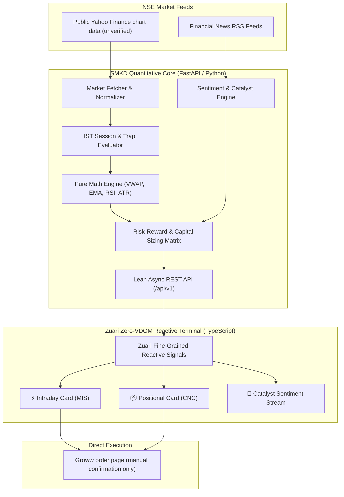

<div align="center">

# ⚡ STOCK MARKET KA DON (SMKD)
### Research and paper-trading signal engine for Indian equities (NSE)

[](#-designed--engineered-by-danger-labs)
[](LICENSE)
[](https://python.org)
[](https://fastapi.tiangolo.com)
[](https://www.typescriptlang.org)
[](#-frontend-architecture)
[](https://www.nseindia.com)

<p align="center">
  <b>A research-oriented market-analysis and decision-support terminal for National Stock Exchange (NSE) equities. Market signals are not broker-verified instructions and this project is not cleared for live-money trading.</b>
</p>

[Key Features](#-key-features) • [System Architecture](#-system-architecture) • [Trading Strategies](#-trading-engine--strategy-matrix) • [Quick Start](#-quick-start--installation) • [API Reference](#-api-specification) • [Limitations & Disclaimer](#-limitations--known-constraints)

---

</div>

## 🧭 Fork Maintainer & Upstream Credit

**This fork is maintained by [@Lord-Nosh](https://github.com/Lord-Nosh).** It is derived from the upstream Stock Market Ka Don project created by **Danger Labs / [@dr-week](https://github.com/dr-week)**. Retain upstream attribution and the project license; this fork focuses first on data integrity, risk guardrails, and operational safety.

> *"Precision over hype. Mathematical expectancy over speculation."* — **Danger Labs Core Philosophy**

---

## 👨‍💻 Creator, Maintainers & Contributors

**Fork maintainer: [@Lord-Nosh](https://github.com/Lord-Nosh). Upstream project: [Danger Labs / @dr-week](https://github.com/dr-week).**

SMKD is an evolving market-analysis and trading research project. Contributions, reproducible bug reports, test improvements, documentation fixes, and thoughtful feature proposals are welcome.

- **Creator / maintainer:** [@dr-week](https://github.com/dr-week)
- **Report a bug:** [Open an issue](https://github.com/Lord-Nosh/STOCK-MARKET-KA-DON/issues/new)
- **Suggest an improvement:** [Feature requests](https://github.com/Lord-Nosh/STOCK-MARKET-KA-DON/issues)
- **Contribute code:** [Open a pull request](https://github.com/Lord-Nosh/STOCK-MARKET-KA-DON/pulls)
- **Contribution guide:** [CONTRIBUTING.md](CONTRIBUTING.md) *(add this file if it does not exist)*

### Repository activity

[](https://github.com/Lord-Nosh/STOCK-MARKET-KA-DON/stargazers)
[](https://github.com/Lord-Nosh/STOCK-MARKET-KA-DON/forks)
[](https://github.com/Lord-Nosh/STOCK-MARKET-KA-DON/issues)
[](https://github.com/Lord-Nosh/STOCK-MARKET-KA-DON/pulls)
[](https://github.com/Lord-Nosh/STOCK-MARKET-KA-DON/commits/main)

### Meet the contributors

Contributions are credited through GitHub's contributor history.

[](https://github.com/Lord-Nosh/STOCK-MARKET-KA-DON/graphs/contributors)

[View all contributors](https://github.com/Lord-Nosh/STOCK-MARKET-KA-DON/graphs/contributors) · [View commit history](https://github.com/Lord-Nosh/STOCK-MARKET-KA-DON/commits/main) · [View releases](https://github.com/Lord-Nosh/STOCK-MARKET-KA-DON/releases)

### How to contribute

1. Open or review an issue before starting a large change.
2. Keep pull requests focused and explain the reason for the change.
3. Include tests or reproducible steps when fixing a bug.
4. Never commit API keys, broker credentials, tokens, or personal data.
5. Do not introduce simulated market data into live application paths.
6. Clearly state what you tested and what remains unverified.

All market-data, signal-generation, and trading-related changes must preserve the project's safety and data-integrity requirements. See the [Issues](https://github.com/Lord-Nosh/STOCK-MARKET-KA-DON/issues) and [Pull Requests](https://github.com/Lord-Nosh/STOCK-MARKET-KA-DON/pulls) pages before contributing.

---

## 📌 Executive Summary

> **Production status:** research-only until a licensed broker/exchange market-data adapter, regression tests, deployment controls, and paper-trading validation are completed. The current public Yahoo Finance chart integration is explicitly unverified and cannot emit execution-eligible BUY/SELL signals.

**SMKD** solves the core challenges faced by active retail and prop traders in Indian markets: execution lag, cognitive overload, emotional whipsaws, and scam-ridden signal services that ignore market friction and repainting. 

By unifying **closed-candle mathematical indicators**, **live Indian financial news sentiment NLP**, **automated risk-to-reward boundary calculations**, and a **custom zero-VDOM fine-grained reactive terminal (Zuari Framework)**, SMKD delivers institutional-grade trade setups directly linked to broker execution cards (Groww MIS/CNC).

---

## 🌟 Key Features

| Capability | Specification | Architectural Highlight |
|:---|:---|:---|
| **Intraday Engine (MIS)** | 5-Minute Timeframe Multi-Indicator Confluence | VWAP + 9/21 Dual EMA + 14-period RSI + ATR Dynamic Volatility Bands |
| **Delivery Engine (CNC)** | Daily / Multi-Week Positional Swing Scanner | Golden/Death Crossover (20/50 EMA), Volume Accumulation & Stage-2 Breakouts |
| **News Catalyst NLP** | RSS-based sentiment research | RSS pipeline parsing Indian business feeds (Moneycontrol, Mint, ET); latency and source coverage are not guaranteed |
| **Zero-VDOM UI Terminal** | Built on Danger Labs' `@zuari` signals system | Sub-millisecond reactive DOM mutations without the overhead of heavy Virtual-DOM engines |
| **Trap Avoidance Engine** | Strict IST Market Session Filter | Flags 9:15–9:45 AM opening traps and blocks low-liquidity noon chop zones |
| **One-Click Broker Deep Links**| Instant Contextual Execution Linkage | Directly opens pre-configured symbol order cards on Groww Web/Mobile |

---

## 🏗️ System Architecture

SMKD is engineered as an event-driven decoupled ecosystem:



### Directory Structure

```text
├── fast-framework/             # Danger Labs Submodule: Zuari Reactive Framework
│   └── packages/stock-bot-ui/  # High-speed reactive frontend client
├── launcher/                   # Process supervisor and daemon runtime manager
│   ├── instance_manager.py     # Port allocation, pid tracking & graceful shutdowns
│   ├── launch.py               # Synchronized dual-stack process orchestration
│   └── start.bat               # Single-click Windows deployment script
└── stock-signal-bot/           # Quantitative signal engine core
    ├── backend/app/            # FastAPI analytical server
    │   ├── api/                # Endpoints (/api/intraday, /api/delivery, /api/news)
    │   ├── core/               # Universe configuration (Nifty 100 constituent list)
    │   ├── indicators/         # Pure vectorized mathematical indicators
    │   ├── market/             # Market hours validation & candle aggregation
    │   ├── news/               # Live Indian market RSS aggregator & sentiment analyzer
    │   └── strategies/         # Mathematical confluence scoring algorithms
    └── docs/                   # Institutional trading manuals & design documentation
```

---

## 📊 Trading Engine & Strategy Matrix

### 1. Intraday Momentum Strategy (`Groww MIS`) — research only
* **Timeframe**: 5-Minute closed candles (Strict anti-repainting policy).
* **Confluence Rules**:
  * **Long Entry**: Price > VWAP, 9-EMA > 21-EMA, RSI between 55 and 70 (Momentum acceleration without exhaustion).
  * **Short Entry**: Price < VWAP, 9-EMA < 21-EMA, RSI between 30 and 45.
* **Risk Parameters**:
  * Illustrative stop-loss pegged to recent swing extremes or $1.5 \times \text{ATR}$.
  * Targets aim for at least **2:1 reward-to-risk**; this ratio does not guarantee positive expectancy or limit gap loss.

### 2. Positional Swing Strategy (`Groww CNC`) — research only
* **Timeframe**: Daily candle confirmation.
* **Confluence Rules**:
  * 20-Day EMA above 50-Day EMA (Golden Trend Confirmation).
  * Volume expansion > $1.5 \times$ 20-day average volume during breakout sessions.
* **Holding Horizon**: 3 to 15 trading days.

### 3. Anti-Scam & Risk Management Guardrails
* **No Unrealistic Claims**: Win rate alone does not establish an edge. Validate with out-of-sample data, realistic costs, slippage, drawdown analysis, and paper trading before considering live deployment.
* **Friction Awareness**: Uses estimated transaction-cost assumptions to reason about small moves. Actual charges vary by segment, side, broker, and order type; no filter can guarantee profitability.
* **Liquid Universe Only**: Scans only **F&O eligible constituent stocks** (Nifty 100) to protect capital against illiquid 5% circuit freezes and auction penalties.

---

## ⚡ Quick Start & Installation

### Prerequisites
- **Python**: 3.11+ (with pip)
- **Node.js**: 18+ & **pnpm**: 9+
- **Git**

### Automated Launch (Windows)
Run the root supervisor script:
```powershell
.\launcher\start.bat
```

### Manual Step-by-Step Setup

#### Step 1: Clone with Submodules
```bash
git clone --recurse-submodules https://github.com/Lord-Nosh/STOCK-MARKET-KA-DON.git
cd STOCK-MARKET-KA-DON
```

#### Step 2: Start Quantitative Backend
```bash
cd stock-signal-bot/backend
python -m pip install -r requirements.txt # (or install: fastapi uvicorn yfinance requests beautifulsoup4)
python -m uvicorn app.main:app --reload --port 8000
```
> The API will be available at `http://127.0.0.1:8000` with interactive Swagger docs at `http://127.0.0.1:8000/docs`.

#### Step 3: Start Reactive Client
In a separate terminal:
```bash
cd fast-framework/packages/stock-bot-ui
pnpm install
pnpm run dev
```
> Launch browser at `http://localhost:5173`.

---

## 📡 API Specification

| Endpoint | Method | Description |
|:---|:---|:---|
| `/api/intraday` | `GET` | Returns 5-minute MIS momentum signals, entry prices, SL, T1, T2, and reasoning. |
| `/api/delivery` | `GET` | Returns daily CNC swing setups with trend ratings and volume metrics. |
| `/api/news` | `GET` | Returns live curated market catalysts and sentiment classifications. |
| `/api/market-status` | `GET` | Returns Indian standard time market phase (Pre-open, Trap, Active, Post-close). |

---

## ⚠️ Limitations & Known Constraints

Active issues, architectural constraints, and enhancement roadmaps are tracked transparently in the **[GitHub Issues tab](https://github.com/Lord-Nosh/STOCK-MARKET-KA-DON/issues)**:

1. **Unverified public market data**: The current Yahoo Finance chart endpoint is not a broker-authoritative live feed. This fork marks it as research-only and blocks execution-eligible signals. Integrate and validate a licensed broker/exchange feed before paper/live execution.
2. **Provider latency**: Data can be delayed, incomplete, cached, throttled, or unavailable. Delay is provider- and instrument-dependent and is not guaranteed.
3. **Automated Order Placement Requires Broker Credentials**: Currently provides verified direct deep-links to Groww order tickets; automated non-supervised trade execution requires active TOTP broker authorization.
4. **Execution slippage**: The backtest has not been established as a production execution simulator. Opening gaps, market impact, partial fills, and latency can make realized execution materially different from calculated levels.

---

## ⚖️ Legal Disclaimer

*Stock Market Ka Don (SMKD) is an educational and analytical research technology platform developed by Danger Labs. It does not constitute financial, investment, or legal advice. Danger Labs and its contributors are not SEBI-registered investment advisors. Equity and derivatives trading involve substantial financial risk. Past statistical performance does not guarantee future market results. Always manage risk responsibly.*

---

<div align="center">
  <sub>Copyright © 2026 <b>Danger Labs</b>. All rights reserved.</sub>
</div>
